# Pustaka Aksara — Aplikasi Pemesanan Buku Toko Online

> **Tugas Ujian Tengah Semester (UTS) Pemrograman Web 1**  
> **Nama :** Astian Handal Cahya Putra  
> **NIM :** 312310527  
> **Program Studi :** Teknik Informatika  

---

## 1. Deskripsi Proyek & Konsep Desain

**Pustaka Aksara** adalah aplikasi pemesanan buku berbasis web *front-end* murni (HTML, CSS, JavaScript) tanpa ketergantungan *backend*, *database*, maupun *framework* (seperti Bootstrap atau React). Seluruh data dikelola langsung melalui variabel JavaScript (`js/data.js`) dan penyimpanan sesi (`sessionStorage`).

### Konsep Desain: *"Kartu Katalog Perpustakaan"*
Desain antarmuka dirancang menggunakan pendekatan khusus yang terinspirasi dari kartu indeks perpustakaan fisik, berkas arsip, nota faktur, dan cap stempel buku besar:
* **Palet Warna Tinta & Kertas:**
  * `--kertas` (`#F4EFE3`): Latar bernuansa kertas arsip.
  * `--kartu` (`#FFFDF7`): Permukaan kartu indeks, tabel, dan formulir.
  * `--tinta` (`#16130F`): Teks utama, garis batas tebal 2px, dan bayangan keras (*offset 4px 4px* tanpa efek blur).
  * `--tinta-lembut` (`#6A6358`): Metadata dan label kode.
  * `--stempel` (`#C8412B`): Aksen tunggal untuk tombol utama, status aktif, pesan peringatan, serta stempel `"HABIS"` dan `"DITERIMA"`.
* **Tipografi:** Google Font tunggal **Montserrat** (bobot 400, 500, 600, 800) dengan fitur angka tabular (`font-variant-numeric: tabular-nums`) untuk nominal harga dan kuantitas stok.
* **Bentuk & Interaksi:** Sudut tegas (`border-radius: 0`), efek tekan tombol bergeser `translate(2px, 2px)`, modal secarik kertas, serta dukungan pengurangan gerak (*prefers-reduced-motion*).

---

## 2. Struktur Berkas Proyek

```text
tugas-uts-web1/
│
├── index.html            # Halaman Login (Kartu Masuk) & Modal Pendaftaran/Lupa Sandi
├── dashboard.html        # Panel Kendali Utama (Greeting waktu, 4 kartu menu, modal laporan)
├── stok.html             # Informasi Stok & Katalog Buku (Tabel dinamis & form tambah stok)
├── checkout.html         # Nota Pemesanan (Keranjang editable, form pemesan & konfirmasi DO)
├── tracking.html         # Pelacakan Pengiriman (Progress tiket berurutan & rincian ekspedisi)
│
├── css/
│   └── style.css         # Stylesheet Utama (External CSS)
│
├── js/
│   ├── data.js           # Berkas Data Dummy (Pengguna, Katalog, Tracking, Pemesanan)
│   └── script.js         # Logika Utama Front-End & Manipulasi DOM
│
├── img/
│   ├── buku1.png s.d. buku8.png  # Sampul Buku Katalog
│
├── README.md             # Dokumentasi Proyek
├── PRD.md                # Product Requirement Document
├── design.md             # Panduan Tampilan, Desain, & Standar Kode Bersih
└── task.md               # Daftar Periksa Pengerjaan
```

---

## 3. Pemenuhan Indikator Penilaian Dosen

| No | Indikator Penilaian | Implementasi Teknis pada Proyek |
|:--:|:---|:---|
| **1** | **HTML Semantik & Valid** | Menggunakan elemen semantik `<header>`, `<nav>`, `<main>`, `<section>`, `<form>`, `<table>` (`<thead>` & `<tbody>`), dan `<footer>`. Seluruh bidang input memiliki `<label for="...">` terkait. Standar W3C dengan atribut `lang="id"`, `meta charset`, dan `meta viewport`. |
| **2** | **Penerapan 3 Jenis CSS** | **a. External CSS:** Berkas [`css/style.css`](css/style.css) sebagai acuan gaya utama seluruh halaman.<br>**b. Internal CSS:** Blok `<style>` khusus di [`tracking.html`](tracking.html) untuk tata letak progress tiket dan garis putus-putus penghubung antar-langkah.<br>**c. Inline CSS:** Contoh atribut `style="display: none;"` pada area hasil pencarian awal di [`tracking.html`](tracking.html). Seluruhnya ditandai komentar untuk kemudahan pengujian dosen. |
| **3** | **JavaScript & Manipulasi DOM** | • **Manipulasi DOM:** Tabel katalog pada `stok.html` dan laporan pada `dashboard.html` di-render dinamis menggunakan `document.createElement`, `textContent`, dan `appendChild`.<br>• **Validasi Form:** Validasi email, kekosongan kolom, format angka, dan pencegahan duplikasi kode buku.<br>• **Manipulasi Data:** Penambahan dan penghapusan baris tabel secara *real-time* dengan animasi sorotan.<br>• **Interaksi UI:** Notifikasi toast, dialog modal tertutup (via tombol Esc, klik luar, atau tombol X), dan alert bawaan. |
| **4** | **Identitas Mahasiswa** | Tercantum seragam di bagian `<footer>` seluruh halaman website:<br>`Dibuat oleh Astian Handal Cahya Putra · NIM 312310527 · UTS Pemrograman Web 1` |

---

## 4. Fitur-Fitur per Halaman

### 4.1 Halaman Login (`index.html`)
* Kartu Masuk dengan validasi format email dan kata sandi.
* Pencocokan data dengan `dataPengguna` pada `js/data.js`.
* Menampilkan pesan alert khusus: **`"Email/password yang Anda masukkan salah"`** apabila autentikasi gagal.
* Modal **Lupa Password** (simulasi kirim instruksi reset) dan Modal **Daftar Akun Baru**.

### 4.2 Dashboard (`dashboard.html`)
* Sapaan otomatis berdasarkan waktu lokal pengguna:
  * `05.00 – 10.59`: Selamat pagi
  * `11.00 – 14.59`: Selamat siang
  * `15.00 – 17.59`: Selamat sore
  * Selain itu: Selamat malam
* Menampilkan nama pengguna yang sedang masuk dari sesi.
* 4 Kartu Menu Indeks (01 Stok/Katalog, 02 Tracking Pengiriman, 03 Laporan Pemesanan [Modal], 04 History Transaksi [Modal]).
* Tombol Keluar (Logout) yang membersihkan sesi pengguna.

### 4.3 Stok / Katalog (`stok.html`)
* Render tabel buku besar dari variabel array `dataKatalogBuku`.
* Penghitung jumlah judul buku aktif (*"8 JUDUL TERCATAT"*).
* Penanda stempel **`HABIS`** otomatis untuk judul dengan sisa stok 0.
* Formulir Tambah Stok Baru yang menambahkan baris langsung ke tabel DOM dengan efek animasi sorot warna.
* Tombol aksi: **Pesan** (menambahkan buku ke keranjang) dan **Hapus** (dengan dialog konfirmasi).

### 4.4 Pemesanan / Checkout (`checkout.html`)
* Format faktur nota: daftar item pesanan dengan tombol ubah jumlah (`+` dan `-`) serta tombol hapus.
* Fitur penambahan buku baru ke keranjang langsung dari menu *dropdown* katalog.
* Perhitungan otomatis subtotal dan total harga pemesanan.
* Formulir identitas pemesan (nama, email, telepon, alamat pengiriman) dan opsi pembayaran (Transfer Bank, E-Wallet, COD, serta jasa ekspedisi).
* Pembuatan nomor Delivery Order otomatis (mis. `DO-2026-0005`) disertai Modal Konfirmasi berstempel resmi.

### 4.5 Tracking Pengiriman (`tracking.html`)
* Formulir pencarian berbasis Nomor Delivery Order (DO).
* Disediakan tombol pintas klik nomor DO contoh untuk mempermudah penilaian dosen.
* Tampilan progres pengiriman bertahap (5 langkah):
  1. *Diproses* &rarr; 2. *Dikemas* &rarr; 3. *Dikirim* &rarr; 4. *Dalam Perjalanan* &rarr; 5. *Diterima*.
* Lingkaran penanda: warna tinta untuk tahapan selesai, warna aksen stempel merah untuk tahapan aktif.
* Stempel merah **`DITERIMA`** muncul jika pesanan telah selesai dikirim.
* Tabel rincian ekspedisi, jenis paket, tanggal kirim, dan total pembayaran.

---

## 5. Akun & Data Pengujian

### Akun Login
* **Email:** `astian@mail.com`
* **Kata Sandi:** `123456`
* *(Atau gunakan akun admin: `admin@tokobuku.com` / `admin123`)*

### Nomor Delivery Order untuk Tracking
* `DO-2026-0001` &rarr; Status: **Diterima** (Langkah 5 / Selesai dengan stempel)
* `DO-2026-0002` &rarr; Status: **Dalam Perjalanan** (Langkah 4)
* `DO-2026-0003` &rarr; Status: **Dikemas** (Langkah 2)
* `DO-2026-0004` &rarr; Status: **Diproses** (Langkah 1)

---

## 6. Petunjuk Menjalankan Aplikasi

Aplikasi ini tidak memerlukan instalasi *web server* (*Apache/Node.js/Nginx*) maupun kompilasi berkas.

1. Buka folder proyek `tugas-uts-web1`.
2. Klik dua kali pada berkas **`index.html`** untuk membukanya pada peramban web modern (Google Chrome, Microsoft Edge, Mozilla Firefox, dll.).
3. Pastikan perangkat terhubung ke internet saat pertama kali dibuka untuk memuat font *Montserrat* dari Google Fonts (tersedia *fallback* sistem font lokal).

---

## 7. Dokumentasi Tangkapan Layar (Screenshots)

Berikut adalah dokumentasi visual seluruh proses dan alur fitur aplikasi saat dijalankan:

### 7.1 Halaman Login & Autentikasi (`index.html`)

#### 1. Formulir Masuk Sistem (Kartu Masuk)
Tampilan kartu identitas masuk di tengah layar dengan gaya kertas arsip:
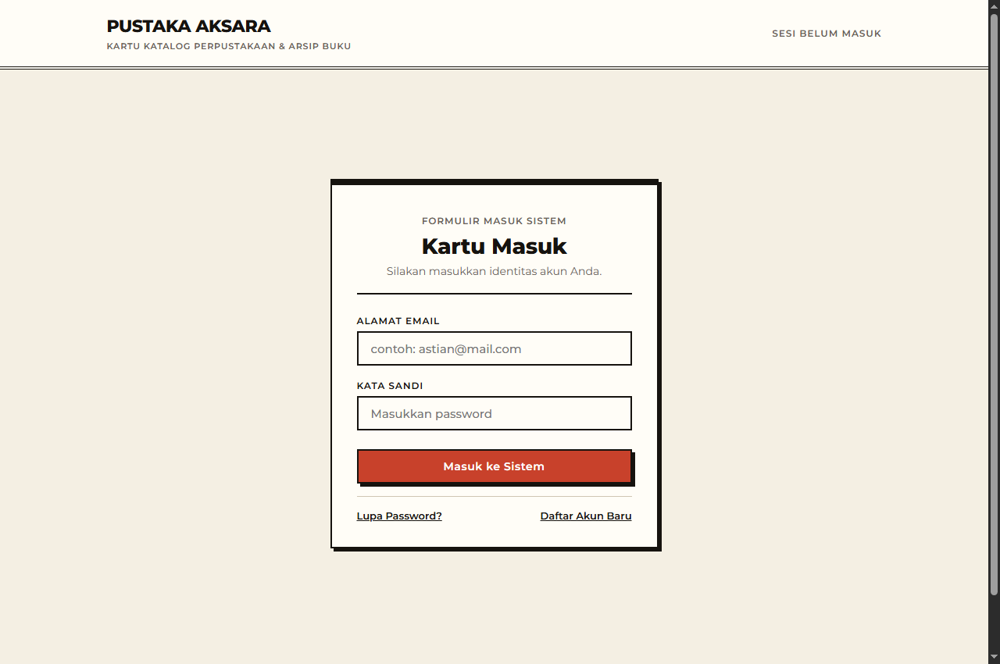

#### 2. Dialog Modal Lupa Password
Fitur pemulihan sandi interaktif:
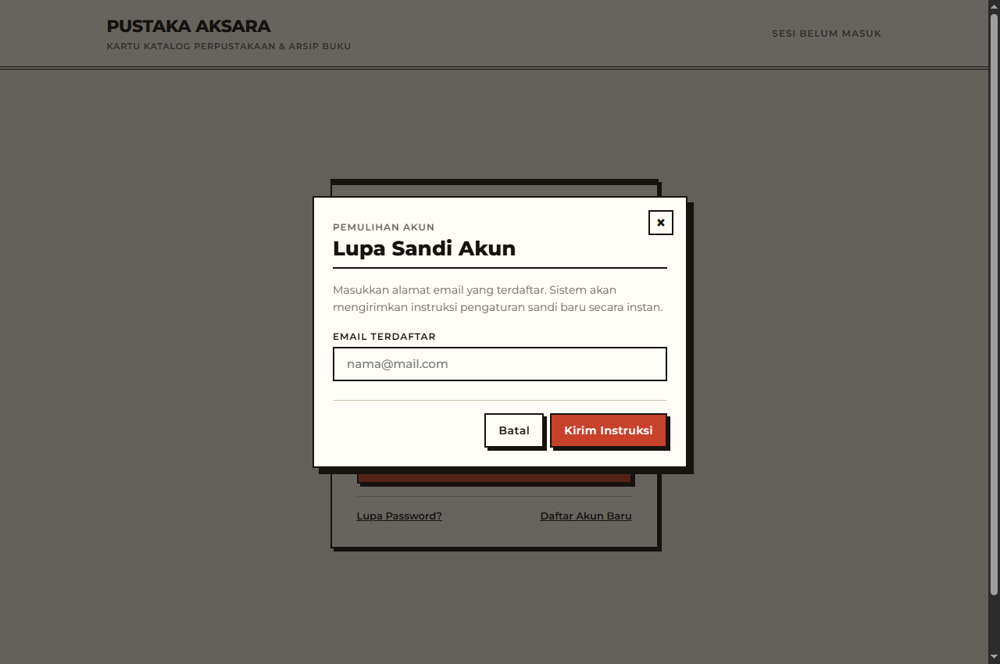

#### 3. Dialog Modal Registrasi Akun Baru
Pendaftaran anggota baru yang langsung tersimpan ke data sistem:
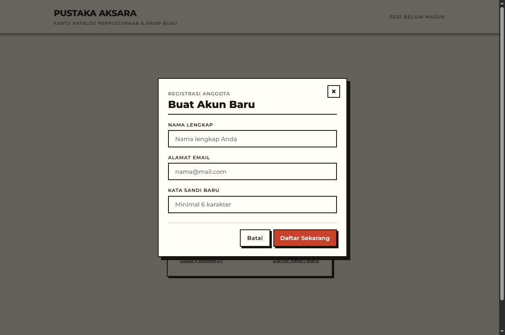

---

### 7.2 Halaman Dashboard (`dashboard.html`)

#### 4. Panel Kendali Utama & Sapaan Waktu Otomatis
Sapaan adaptif (*Selamat pagi/siang/sore/malam*) dan 4 kartu menu arsip (2x2):


#### 5. Modal Laporan Pemesanan Buku
Tabel rekapitulasi seluruh pesanan yang masuk:
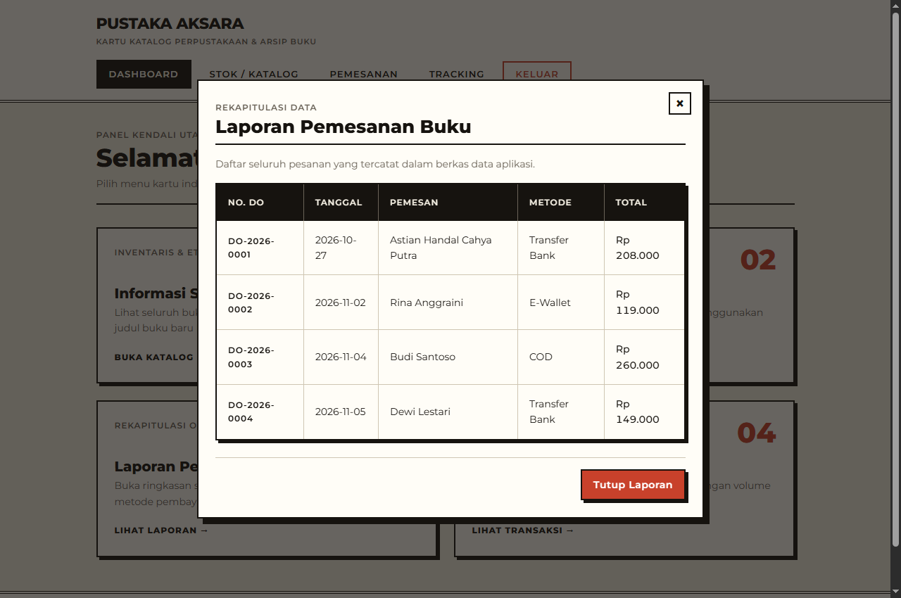

#### 6. Modal History Transaksi
Catatan riwayat transaksi keuangan dan volume eksemplar buku:
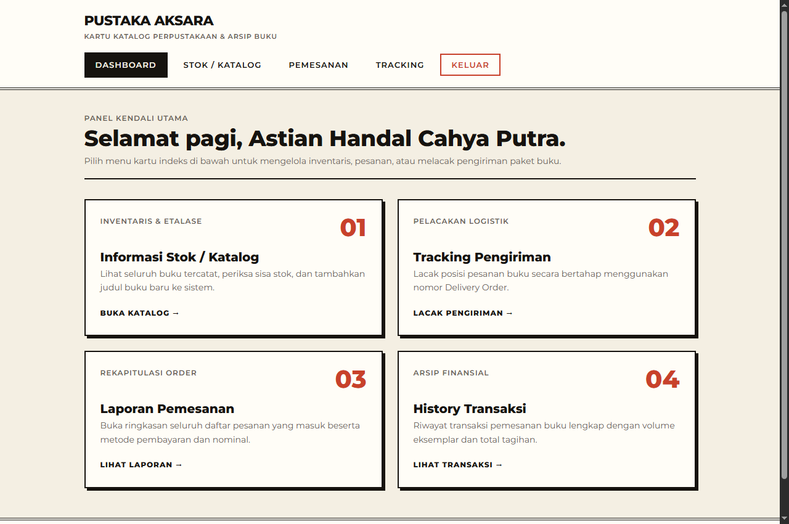

---

### 7.3 Halaman Stok & Katalog (`stok.html`)

#### 7. Tabel Buku Besar Inventaris & Status HABIS
Tabel dinamis dari JavaScript dengan indikator stempel **HABIS** otomatis:
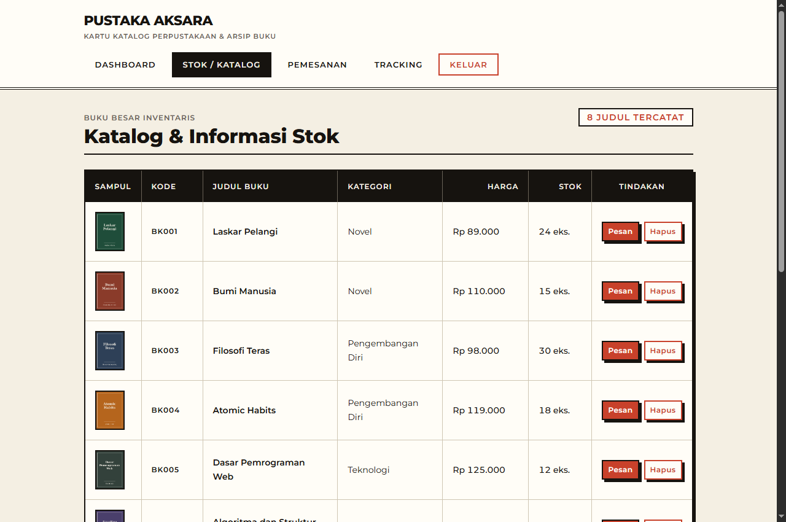

#### 8. Tambah Stok Buku Baru (Manipulasi DOM)
Penambahan data baru melalui form yang langsung disisipkan ke DOM dengan animasi sorotan:
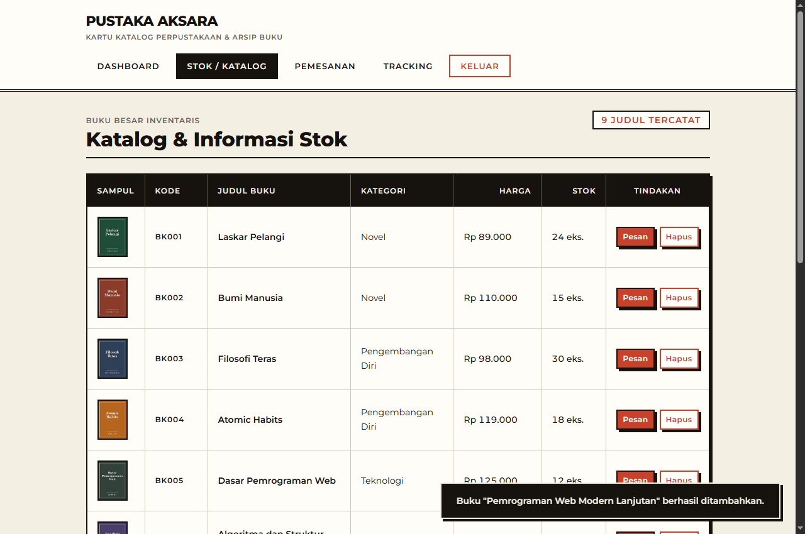

---

### 7.4 Halaman Pemesanan / Checkout (`checkout.html`)

#### 9. Lembar Faktur Nota Belanja & Formulir Pemesan
Kelola kuantitas keranjang (+/-) dan kalkulasi total otomatis di atas garis putus-putus:
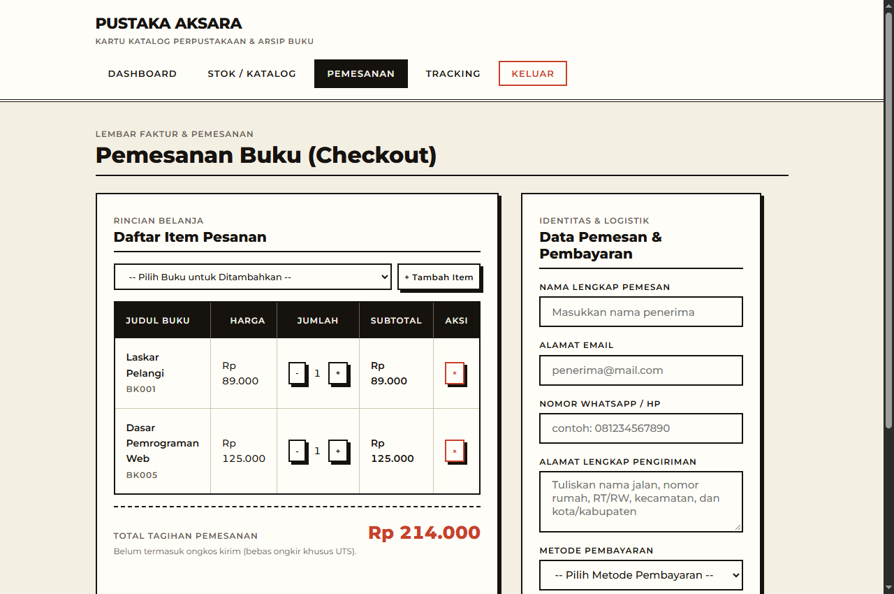

#### 10. Validasi Formulir Pemesanan
Pesan kesalahan spesifik di bawah field yang belum terisi dengan benar:
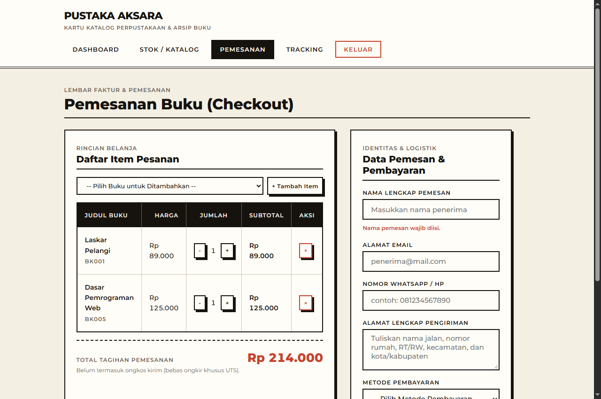

#### 11. Modal Konfirmasi Surat Pesanan & Stempel Nomor DO
Penerbitan nomor Delivery Order resmi dan stempel validasi:


---

### 7.5 Halaman Tracking Pengiriman (`tracking.html`)

#### 12. Pelacakan Sukses (Progres Tiket 5 Tahap & Stempel DITERIMA)
Status visual perjalanan paket menggunakan Internal CSS dengan stempel akhir:


#### 13. Penanganan Kesalahan Nomor DO Tidak Ditemukan
Pemberitahuan error jika nomor DO tidak terdaftar dalam arsip:
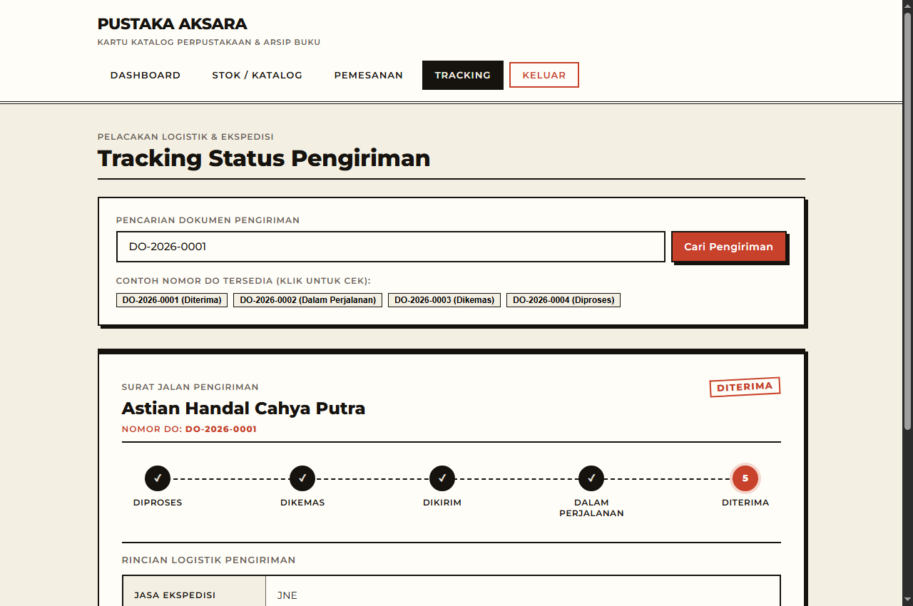

---

### 7.6 Tampilan Responsif (Mobile 375px)

#### 14. Tampilan Mobile Dashboard
Penyesuaian tata letak grid menjadi 1 kolom vertikal pada layar smartphone:
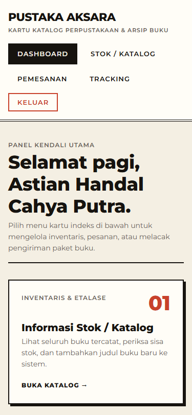

#### 15. Tampilan Mobile Tracking Pengiriman
Jalur progres tiket pengiriman yang bertransformasi menjadi garis vertikal responsif:
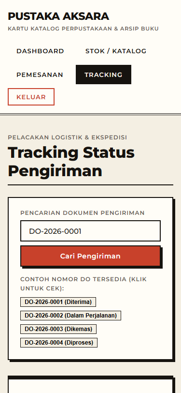

